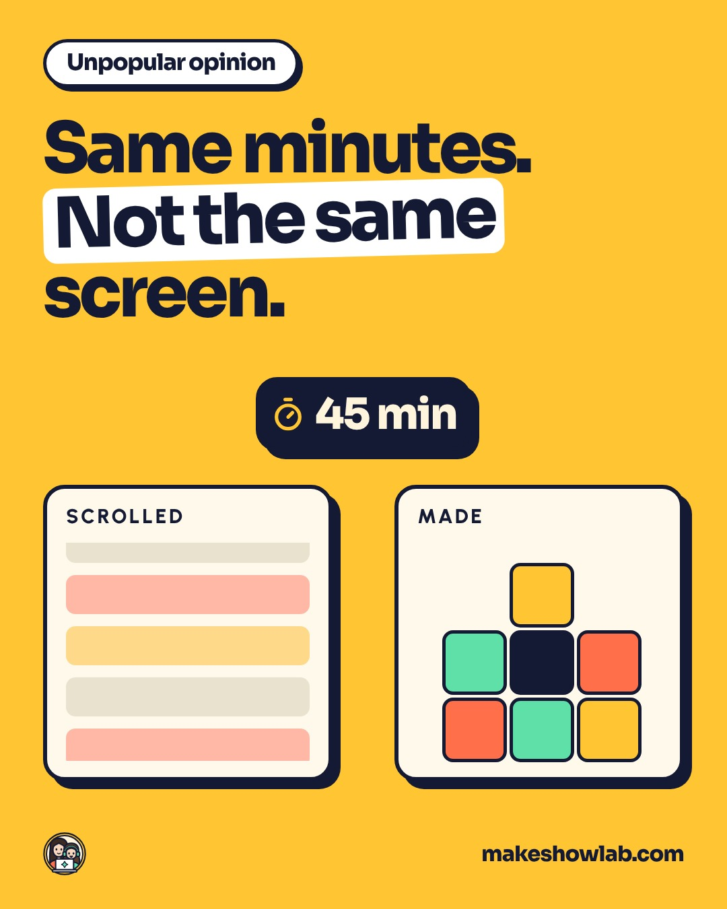
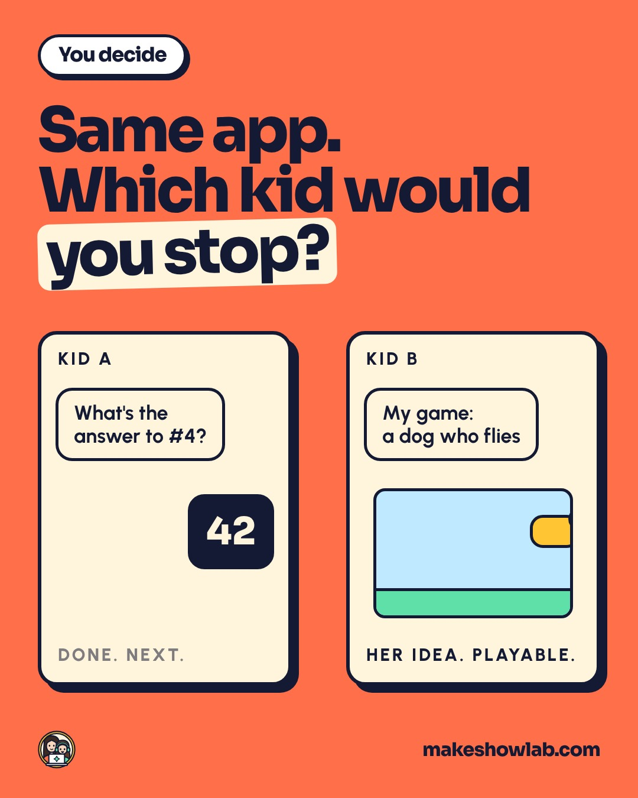
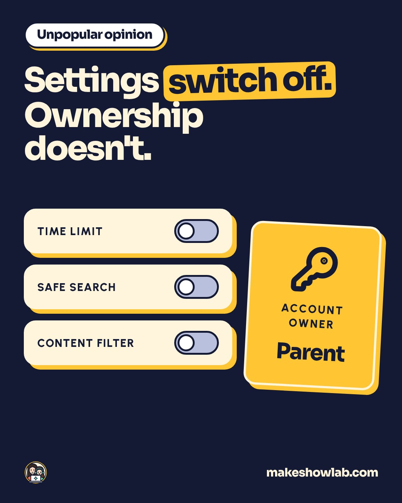
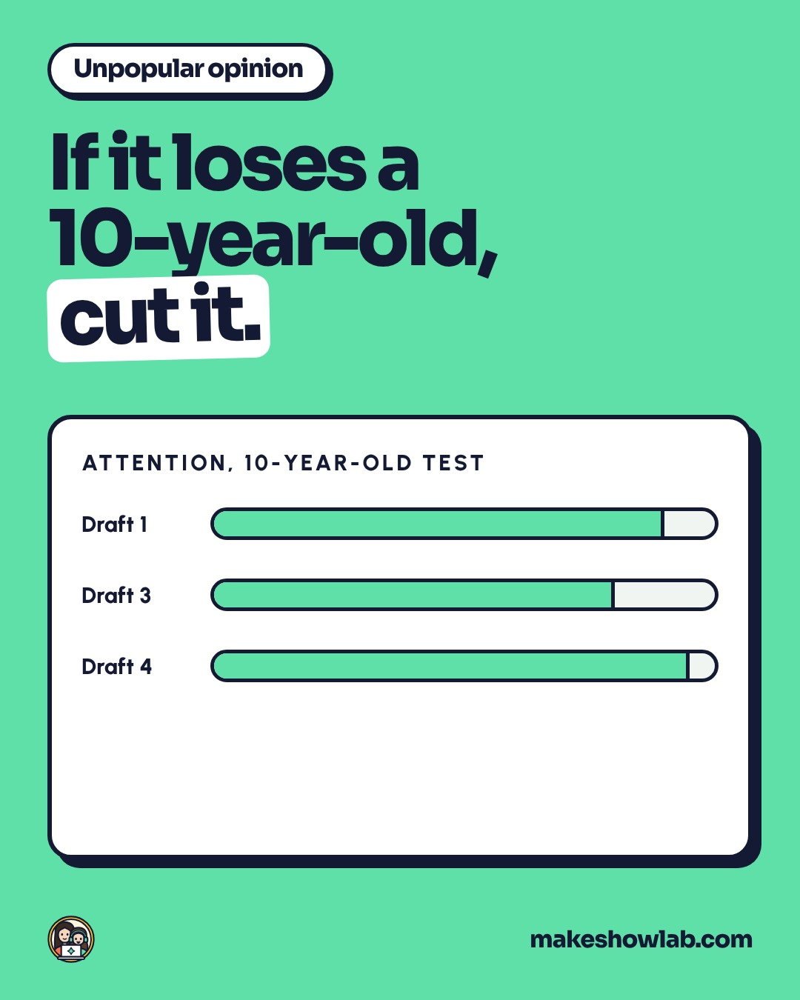
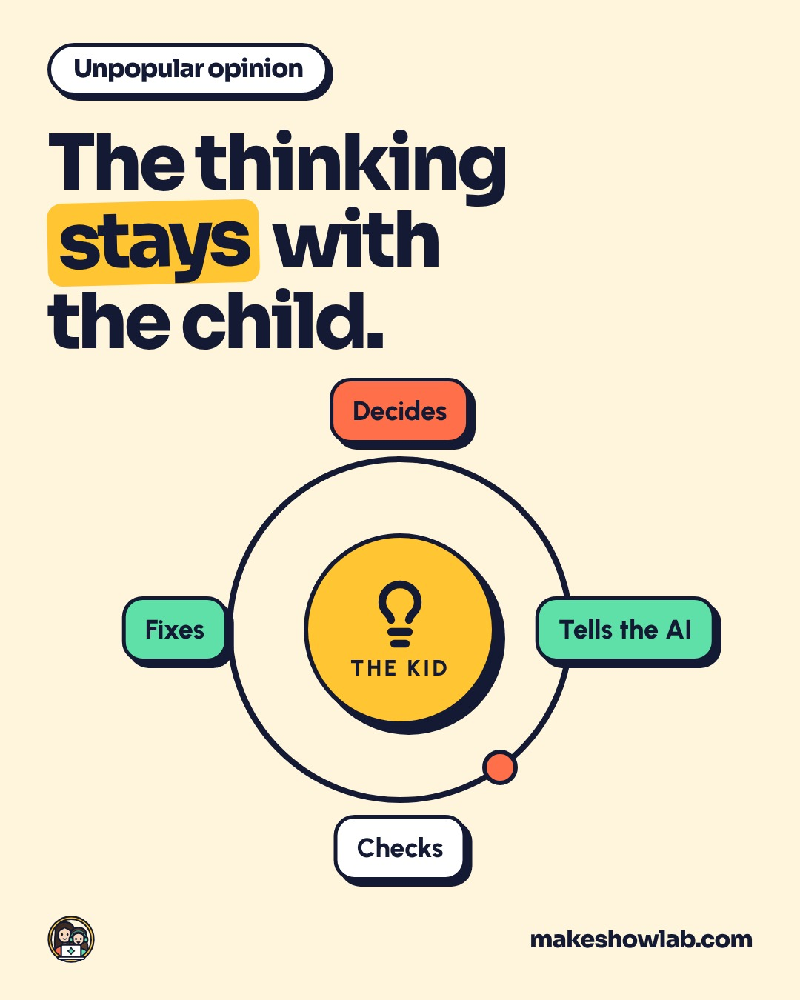

# Threads · все посты на вычитку

Здесь все 18 постов для Threads: английский текст (он и выйдет), перевод на русский (только для вас) и карточка, если она уже нарисована.
Правки пишите прямо сюда или в чат с номером поста. Я перенесу их в исходники, пересоберу и обновлю Metricool.

- **Часть 1.** Пять постов, которые уже стоят в Metricool. Время везде нью-йоркское (20:40), во Вьетнаме это 8:40 утра следующего дня.
- **Часть 2.** Семь постов, которые ещё никуда не поставлены (они есть и в варианте для X).
- **Часть 3.** Шесть постов только для Threads, по формулам первой строки.

---

## Часть 1. Уже в расписании Metricool

### 1 · чт 12 ноября · Unpopular opinion · тема: Parenting

> Unpopular opinion: the screen-time fight is the wrong fight.
>
> Kids don't need more minutes or fewer minutes. They need a reason to show you something. A screen she makes on is not a screen she scrolls.
>
> Plenty of parents count minutes and it works for them. So tell me honestly: what matters more in your house, how long or what for?

**Перевод.** Непопулярное мнение: спор о минутах за экраном — не тот спор. Детям не нужно больше или меньше минут. Им нужен повод что-то вам показать. Экран, на котором она создаёт, — не тот экран, который она листает. Многие родители считают минуты, и им это помогает. Так скажите честно: что важнее у вас дома — сколько или зачем?

### 2 · пт 13 ноября · You decide · тема: AI for kids

> You decide: is this a good use of AI or not?
>
> Kid A asks a chatbot for the answer to a homework question. Kid B tells the same chatbot about a game she made up, and builds it.
>
> Same app, same screen. Where's the line for you, and which kid would you stop?

**Перевод.** Решайте сами: это хорошее использование ИИ или нет? Ребёнок А спрашивает у чат-бота ответ на задачу из домашки. Ребёнок Б рассказывает тому же чат-боту про игру, которую придумала сама, и собирает её. То же приложение, тот же экран. Где для вас граница и какого ребёнка вы бы остановили?

### 3 · сб 14 ноября · Unpopular opinion · тема: AI safety

> Unpopular opinion: parental controls are not an AI safety plan.
>
> The rule that does the most in our house is boring. The account is mine, not hers. Every tool runs on the parent's account, my kid never signs up for anything alone, and I see everything she makes.
>
> Settings get switched off. Ownership doesn't. Am I wrong? What's your one rule that actually holds?

**Перевод.** Непопулярное мнение: родительский контроль — это не план безопасности с ИИ. Правило, которое больше всего работает у нас дома, скучное: аккаунт мой, а не её. Все сервисы работают на аккаунте родителя, ребёнок нигде не регистрируется сам, и я вижу всё, что она делает. Настройки отключаются. Право владения — нет. Я неправа? Какое ваше единственное правило действительно держится?

### 4 · пн 16 ноября · Unpopular opinion · тема: Parenting

> Unpopular opinion: if a kids' course can't hold a 10-year-old's attention, it doesn't matter who designed it.
>
> I built every lesson of ours myself, then tested each one on my daughter Kamilla at the kitchen table. She's 10 and she argues with the script. What lost her got cut.
>
> Who would you trust more to judge something made for kids: an expert or a kid?

**Перевод.** Непопулярное мнение: если детский курс не удерживает внимание десятилетнего, неважно, кто его придумал. Я сама сделала каждый наш урок и проверила каждый на дочери Камилле за кухонным столом. Ей 10, и она спорит со сценарием. Что её теряло, мы вырезали. Кому вы больше доверите оценить вещь для детей: эксперту или ребёнку?

⚠️ Здесь есть имя Камиллы. Если убрать, будет «my 10-year-old». Решить до понедельника.

### 5 · вт 17 ноября · Unpopular opinion · тема: AI for kids

> Unpopular opinion: AI is not the reason a kid stops thinking.
>
> A kid stops thinking when nobody asks what they think first. When the child decides what to make, tells the AI, checks what comes back and fixes it, the thinking stays with the child.
>
> Don't let AI think for your child. Teach them to think with it.
>
> Agree or not? I'd really like to hear from the parents who don't.

**Перевод.** Непопулярное мнение: ИИ — не причина, по которой ребёнок перестаёт думать. Ребёнок перестаёт думать, когда его никто сначала не спрашивает, что думает он. Когда ребёнок решает, что сделать, говорит ИИ, проверяет результат и исправляет, думает именно он. Не давайте ИИ думать за ребёнка. Научите думать вместе с ним. Согласны или нет? Очень хочу услышать тех, кто не согласен.

---

## Часть 2. Готовы, но ещё не в расписании (карточек пока нет)

### 6 · Unpopular opinion · тема: AI safety
> Unpopular opinion: banning AI at home won't keep your kid away from it.
>
> Almost 9 in 10 American kids aged 9 to 17 already use AI. Almost half have never talked about safety with a parent (Common Sense Media, 2026).
>
> A ban mostly decides one thing: whether they learn it with you or without you.
>
> If you've said no to AI at home, I'd honestly like to hear why. What would change your mind?

**Перевод.** Непопулярное мнение: запрет ИИ дома не убережёт от него ребёнка. Почти 9 из 10 американских детей 9–17 лет уже пользуются ИИ. Почти половина никогда не говорила о безопасности с родителем (Common Sense Media, 2026). Запрет решает в основном одно: научится ребёнок с вами или без вас. Если вы сказали ИИ «нет», правда хочу услышать почему. Что изменило бы ваше мнение?

### 7 · You decide · тема: Parenting
> You decide: how young is too young for AI, if a parent is right there?
>
> Here's how it goes in our course. A six-year-old talks and you type. A ten-year-old does most of it alone. A teenager just needs you in the room. The idea is always theirs.
>
> I know some of you will say six is too early. Where do you draw the line, and why?

**Перевод.** Решайте сами: в каком возрасте ИИ рано, если родитель рядом? У нас на курсе так: шестилетний говорит, вы печатаете. Десятилетний делает почти всё сам. Подростку нужно только, чтобы вы были в комнате. Идея всегда его. Знаю, кто-то скажет, что шесть лет — рано. Где ваша граница и почему?

### 8 · You decide · тема: Gift ideas
> You decide: do kids want a box to open, or time with you?
>
> Linda, a grandmother from our early-access group (she got the course free), told us:
>
> "I wanted to give my grandson something more meaningful than another toy. MakeShowLab gave us a fun way to spend time together."
>
> Plenty of kids would still pick the box. Honestly, which would yours pick?

**Перевод.** Решайте сами: дети хотят коробку с подарком или время с вами? Линда, бабушка из группы раннего доступа (курс она получила бесплатно), написала нам: «Я хотела подарить внуку что-то более значимое, чем ещё одна игрушка. MakeShowLab дал нам весёлый способ проводить время вместе». Многие дети всё равно выберут коробку. Честно, а ваш что выбрал бы?

### 9 · Unpopular opinion · тема: AI for kids
> Unpopular opinion: a quiz is a weak way to check what a kid learned.
>
> A quiz tells you what a kid remembers. A thing they made tells you what they can do. That's why our lessons are 6 to 20 minutes of making, and each one ends with a game, a cartoon or a song instead of a test.
>
> Teachers and parents, push back on this one: what does a quiz show you that a finished thing can't?

**Перевод.** Непопулярное мнение: тест — слабый способ проверить, чему ребёнок научился. Тест показывает, что ребёнок запомнил. Сделанная вещь показывает, что он умеет. Поэтому наши уроки — 6–20 минут работы руками, и каждый заканчивается игрой, мультфильмом или песней вместо теста. Учителя и родители, поспорьте со мной: что показывает тест, чего не покажет готовая вещь?

### 10 · You decide · тема: AI for kids
> You decide: did she make it?
>
> Say your 8-year-old describes a song in her own words. AI writes the music. She sings it for grandma.
>
> Some will say the AI made it. Some will say she did. My answer: the idea and the words are hers, the AI is the tool.
>
> Yes or no, and where exactly is the line for you?

**Перевод.** Решайте сами: это она сделала? Допустим, ваша восьмилетняя дочь своими словами описывает песню. Музыку пишет ИИ. Она поёт её бабушке. Кто-то скажет, что сделал ИИ. Кто-то, что она. Мой ответ: идея и слова её, ИИ — инструмент. Да или нет, и где именно для вас граница?

### 11 · Предложение · тема: AI for kids
> The fastest way to decide how you feel about kids and AI is not another article. It's one evening.
>
> The first lesson of our course is free. No card, one email. Your kid builds a playable game in 10 to 20 minutes, then you play it against each other on the same couch.
>
> https://www.makeshowlab.com/?utm_source=threads&utm_medium=social&utm_campaign=free-lesson#free
>
> If you try it, come back and tell me: did it change your mind, or confirm it?

**Перевод.** Быстрее всего понять, как вы относитесь к детям и ИИ, не через ещё одну статью, а за один вечер. Первый урок курса бесплатный. Без карты, только почта. Ребёнок за 10–20 минут делает игру, в которую можно играть, и вы играете друг против друга на одном диване. [ссылка] Если попробуете, вернитесь и расскажите: это изменило ваше мнение или подтвердило?

### 12 · You decide · тема: AI for kids
> You decide: 20 minutes tonight. Your kid makes their own game, or learns to spot a fake picture?
>
> Both are in our course. One is pure fun. The other might matter more.
>
> If you only had time for one this week, which would you pick for your kid?

**Перевод.** Решайте сами: 20 минут сегодня вечером. Ребёнок делает свою игру или учится распознавать фейковую картинку? Оба урока есть в курсе. Один — чистое удовольствие. Другой, возможно, важнее. Если бы на этой неделе было время только на один, что бы вы выбрали для ребёнка?

---

## Часть 3. Только для Threads, по формулам первой строки (карточек пока нет)
Номер формулы указан по вашему списку (подробности в `threads-hooks.md`).

### T1 · формула 5 «Честно, я не понимаю…» · тема: Parenting
> Honestly, I don't get why an hour of scrolling feels normal and 20 minutes of making something with AI feels scary.
>
> One ends with nothing. The other ends with a game, a cartoon or a song your kid can show you.
>
> I'm not saying screens are fine. I'm saying not all screen time is the same.
>
> So which one worries you more at your house, and why?

**Перевод.** Честно, не понимаю, почему час листания ленты кажется нормой, а 20 минут творчества с ИИ пугают. Первое заканчивается ничем. Второе заканчивается игрой, мультфильмом или песней, которую ребёнок может вам показать. Я не говорю, что экраны — это хорошо. Я говорю, что экранное время бывает разным. Так что беспокоит вас больше и почему?

### T2 · формула 13 «Если тебе (возраст)…» · тема: Parenting
> If your kid is 6, here's your job with AI: they talk, you type.
>
> At 6 the ideas are big and the typing is slow. So the child describes, you type it in, and they decide if what comes back is right. At 10 most kids do it alone. A teenager just needs you in the room.
>
> The idea is always theirs.
>
> Parents of 6-year-olds: would you let yours try this, or is it too early?

**Перевод.** Если ребёнку 6, ваша задача с ИИ такая: он говорит, вы печатаете. В шесть идеи большие, а печатать медленно. Поэтому ребёнок описывает, вы вводите, и он решает, подходит ли результат. В 10 большинство детей делают это сами. Подростку нужно только, чтобы вы были в комнате. Идея всегда его. Родители шестилеток: дали бы своему попробовать или рано?

### T3 · формула 1 «Все молчат, а я скажу…» · тема: AI for kids
> Not many parents say this out loud, so I will: I'd rather my kid argue with an AI than obey it.
>
> AI gets things wrong. A picture comes out strange, an answer sounds sure and isn't. A kid who checks, pushes back and asks again is learning the most useful thing AI can teach.
>
> Do you want your kid to trust AI, or to question it?

**Перевод.** Немногие родители говорят это вслух, поэтому скажу я: пусть лучше мой ребёнок спорит с ИИ, чем слушается его. ИИ ошибается. Картинка выходит странной, ответ звучит уверенно, но неверен. Ребёнок, который проверяет, возражает и спрашивает снова, учится самому полезному, чему может научить ИИ. Вы хотите, чтобы ребёнок доверял ИИ или сомневался в нём?

### T4 · формула 20 «Давай узнаем твой уровень» · тема: AI for kids
> Quick check: what's your family's AI level right now?
>
> 1. Never tried it
> 2. Homework answers
> 3. My kid made something with it
> 4. My kid showed it to someone
>
> No wrong answer. Which number are you, and would you like to move up a level or stay put?

**Перевод.** Быстрая проверка: какой у вашей семьи сейчас уровень с ИИ? 1. Не пробовали. 2. Ответы для домашки. 3. Ребёнок что-то с ним сделал. 4. Ребёнок показал это кому-то. Неправильных ответов нет. Какой у вас номер, и хотите подняться на уровень выше или остаться?
(Эти же четыре варианта поставим во встроенный опрос Threads.)

### T5 · формула 4 «Вот 3 вещи…» · тема: AI safety
> 3 things to settle before your kid opens an AI app:
>
> 1. The account is yours. They never sign up for anything alone.
> 2. Some things AI never hears. Decide together what they are.
> 3. If it looks too perfect, check it. Pictures, videos and texts can be fake.
>
> Settle these three, and the fight about minutes gets a lot smaller.
>
> What would you add as number 4?

**Перевод.** Три вещи, которые стоит решить до того, как ребёнок откроет приложение с ИИ. 1. Аккаунт ваш. Ребёнок нигде не регистрируется сам. 2. Кое-что ИИ никогда не узнает. Решите вместе, что именно. 3. Если выглядит слишком идеально, проверь. Картинки, видео и тексты бывают фейковыми. Решите эти три, и спор о минутах станет намного меньше. Что бы вы добавили четвёртым?

### T6 · формула 8 «Все твердят… но никто не показывает как» · тема: AI for kids
> Everyone says "teach your kids AI." Very few show what that looks like on a Tuesday night.
>
> Here's ours, in one loop. Watch: see a finished thing first. Make: your kid makes their own, you sit next to them. Show: play it, share it, send it to grandma.
>
> 6 to 20 minutes, and it ends with a thing, not a quiz.
>
> What does "teaching AI" look like at your house, if anything?

**Перевод.** Все говорят: «Учите детей ИИ». Очень немногие показывают, как это выглядит вечером во вторник. Вот наш вариант, одним кругом. Смотрим: сначала видим готовую вещь. Делаем: ребёнок делает свою, вы рядом. Показываем: играем, делимся, отправляем бабушке. 6–20 минут, и в конце готовая вещь, а не тест. А как «учить ИИ» выглядит у вас дома, если вообще выглядит?
